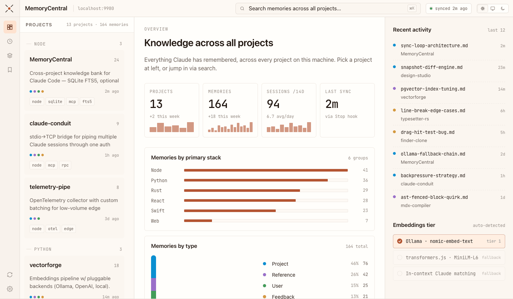
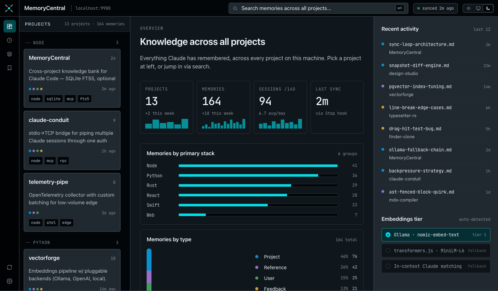
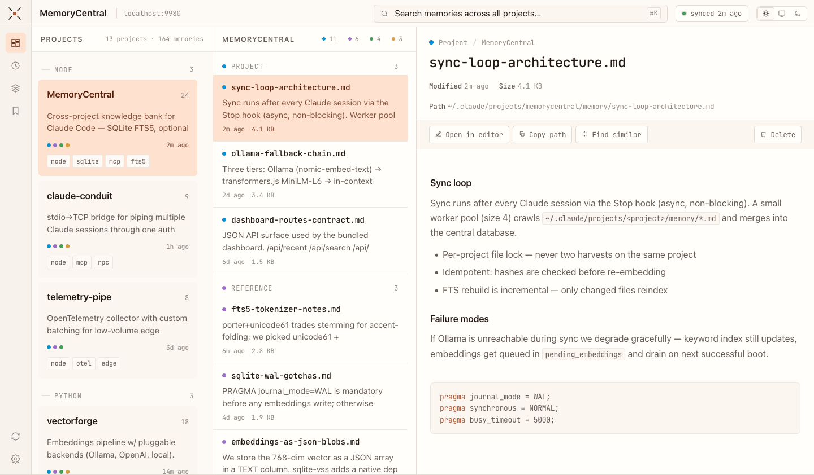
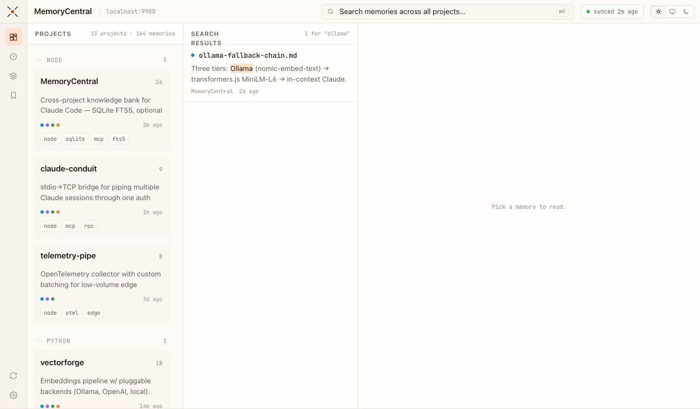

<p align="center">
  
</p>

<p align="center">One memory for every project and every AI tool you use.<br>Decisions, fixes and gotchas saved in one tool become searchable from all the others.</p>

<p align="center"><strong>macOS · Windows · Linux</strong> &nbsp;·&nbsp; Claude Code · GitHub Copilot · Codex · OpenCode · any MCP client</p>

---



<details>
<summary>More screenshots</summary>







</details>

---

## What it does

- **One shared memory, any AI tool.** Anything that speaks MCP can save to it and search it. Claude Code, VS Code with Copilot, Codex and OpenCode have ready-made setup snippets.
- **Imports what you already have.** Claude Code's existing project memories are indexed where they are, and whatever it writes later keeps flowing in. Memories from tools without a memory system of their own go to MemoryCentral's store.
- **Finds things by meaning or by name.** Semantic search ("how did we handle retries?") plus full-text search, across every project.
- **Never loses knowledge by accident.** A missing or unreadable folder never deletes anything. Deleted memories can be restored for 30 days. See [storage and retention](docs/storage-and-retention.md).
- **Local and private.** Plain Markdown files and one SQLite database on your machine. Embeddings run locally, with Ollama or built in.
- **A dashboard** at `http://localhost:9980` to browse, search, set up and manage it all.

## Requirements

| | |
|---|---|
| **Node.js 22+** | [nodejs.org](https://nodejs.org) (uses the built-in `node:sqlite`) |
| **Git** | to clone the repository |
| **Ollama** *(optional, recommended)* | [ollama.com](https://ollama.com), for the best semantic search. Without it, MemoryCentral uses a built-in engine. |

## Install

```bash
git clone https://github.com/yogiee/MemoryCentral
cd MemoryCentral
node setup.js
```

`setup.js` installs dependencies on first run, then opens the dashboard in your browser, where setup takes a few steps:

1. **Welcome.** It shows what it found on this machine, including existing AI-tool memories it will import.
2. **Choose a search engine.**
   - **Ollama:** best quality; runs as a separate app. If it isn't installed, you get the install command for your OS.
   - **Built-in:** nothing to install; runs on your CPU.
3. **Set up the engine.** Pick a model; only models that run on your machine are offered. It downloads with a progress bar.
4. **Import & index.** Your existing memories become searchable.
5. **Connect your apps.** Copy-ready registrations for each AI tool, with this machine's paths filled in. See [connecting apps](docs/connecting-apps.md).
6. **Project blocks.** An optional short block per project. It names and describes the project and tells the AI to use MemoryCentral. See [project blocks](docs/project-block.md).

Then restart your AI tools. That's it: MemoryCentral keeps itself current from then on.

Run `node setup.js` any time later to open the dashboard without any AI tool running.

## Using it

Once connected, your AI tool knows when to reach for MemoryCentral. MemoryCentral sends it instructions: search before implementing, fixing or researching, and save what it learns. You can also just ask: *"how did we handle auth in the other project?"*

| Tool | For |
|---|---|
| `find_similar` | Search by meaning across every project |
| `search_memories` | Search for names: a library, an error message, a command |
| `find_by_stack` | Projects using a technology |
| `save_memory` / `delete_memory` | Create, update or remove a memory |
| `set_project_info` | Describe a project that has no description yet |
| `list_projects`, `get_project_summary`, `get_project_memories`, `get_dashboard` | Browse |
| `sync` | Re-read every memory folder now (it also happens on its own) |

Details: [MCP tools](docs/mcp-tools.md) · [Using MemoryCentral well](docs/usage.md).

## The dashboard

`http://localhost:9980` is available while any connected AI tool is running, or on its own via `node setup.js`.

- **Browse:** projects grouped by stack, each project's memories by type, the full memory rendered in place
- **Search:** full-text with highlighted excerpts (⌘K / Ctrl+K)
- **Settings:** search engine and model, connect apps, project blocks, every memory folder and its status, recently deleted memories
- Light, dark and system themes

## Search engines

| | Ollama | Built-in |
|---|---|---|
| Install | Ollama app + one model download (~0.6 GB) | nothing; one-time model download |
| Runs on | GPU (local or another machine) | CPU, inside MemoryCentral |
| Quality | best overall | on par for specific facts and everyday queries; weaker on broad topic searches |
| Model | `embeddinggemma-2` on Apple Silicon, `embeddinggemma:300m` elsewhere | MiniLM-L6 (23 MB, indexes ~700 memories in under a minute); EmbeddingGemma optional |

You can switch any time in Settings. MemoryCentral re-indexes in the background, and keyword search keeps working throughout. How the models were chosen: [embedding evaluation](docs/embedding-eval-2026-10-09.md).

## Backup and restore

```bash
node export.js                  # → memoryCentral-backup-YYYY-MM-DD.json.gz
node import.js <backup-file>    # on any machine, after node setup.js
```

A backup holds every memory from every source, plus projects, settings and recently deleted memories. Restoring puts files back where they came from, or into MemoryCentral's own store if that folder doesn't exist on the new machine.

## Where things live

```
~/.memorycentral/            MemoryCentral's data (override: MEMORYCENTRAL_HOME)
  memorycentral.db           the index: memories, full-text, vectors, settings
  projects/<name>/memory/    memories MemoryCentral owns
  models/                    built-in embedding models
~/.claude/projects/*/memory  Claude Code's memories, read in place
```

The repository contains only the engine. No personal data is ever committed.

## Documentation

| | |
|---|---|
| [Architecture](docs/architecture.md) | every component and how they fit together |
| [Connecting apps](docs/connecting-apps.md) | Claude Code, VS Code, Codex, OpenCode, others |
| [MCP tools](docs/mcp-tools.md) | what each tool does |
| [Project blocks](docs/project-block.md) | the per-project `## Project` block |
| [Using MemoryCentral well](docs/usage.md) | what to save, how to search |
| [Storage and retention](docs/storage-and-retention.md) | where memories live and when anything is removed |
| [Configuration](docs/configuration.md) | settings and environment variables |
| [Troubleshooting](docs/troubleshooting.md) | when something isn't working |
| [Embedding evaluation](docs/embedding-eval-2026-10-09.md) | how the search models were chosen |

## Upgrading from an earlier version

Pull, then reconnect MemoryCentral in each AI tool, or restart the tools, so none keeps running old code. The first start moves the index into `~/.memorycentral/` (the old `stats/knowledge.db` stays as a backup), imports `~/.memorycentralrc.json`, and skips onboarding. Projects now take their description from a [project block](docs/project-block.md); the Ollama extraction model is no longer used.

## Built with

Node.js 22 (`node:sqlite`) · SQLite FTS5 · [@modelcontextprotocol/sdk](https://github.com/modelcontextprotocol/typescript-sdk) · [Ollama](https://ollama.com) · [transformers.js](https://huggingface.co/docs/transformers.js) · no build step, no native dependencies
